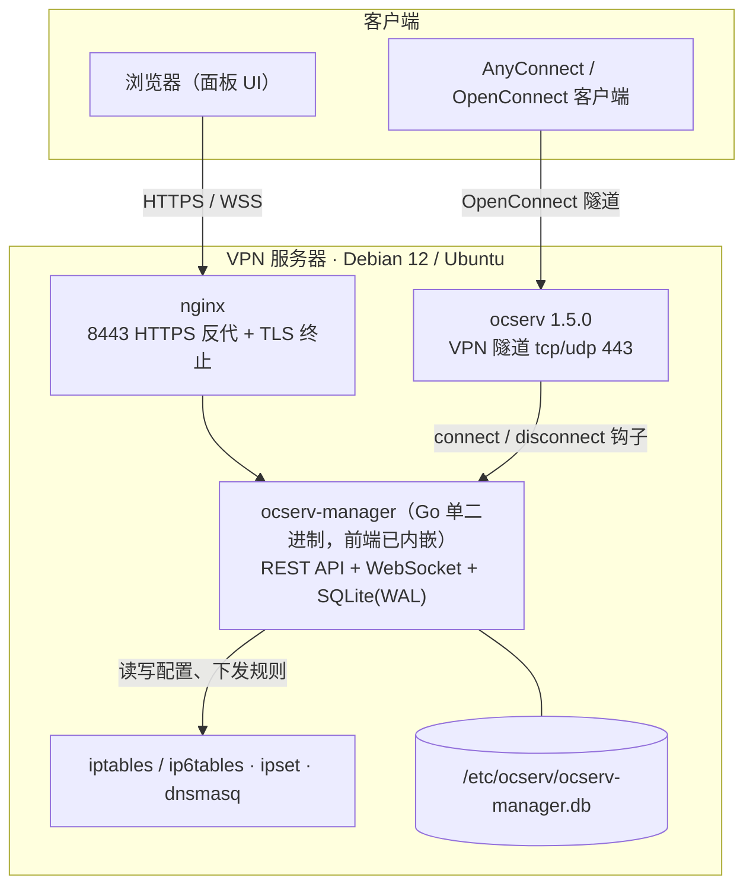
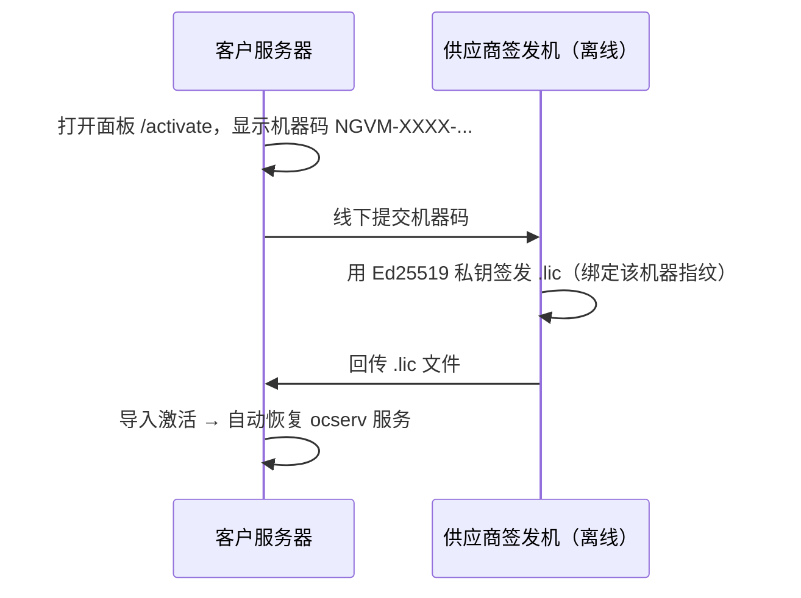

<div align="center">

# Netglimmer VPN Manager

**基于 ocserv 的企业级 OpenConnect VPN 管理面板 · 一键部署 · 全链路可离线**

**中文** ｜ [English](README_EN.md)


[快速开始](#快速开始) · [获取发布包](#获取发布包) · [功能地图](#功能地图) · [架构](#架构) · [安装流程](#安装流程) · [离线授权](#离线授权) · [常见问题](#常见问题)

</div>

---

Netglimmer 把 [ocserv](https://ocserv.gitlab.io/www/ocserv.html)（OpenConnect / Cisco AnyConnect 兼容协议）的 VPN 服务，包装成一个**单二进制、可离线部署、带 Web 控制台**的成品：26 个功能页覆盖账号、网络策略、证书、态势感知与备份，安装脚本负责从零把一台干净的 Debian/Ubuntu 机器装成可用的 VPN 网关，失败还会自动回退。

| | |
|:--|--|
| **交付形态** | 一个 15 MB 预编译二进制（前端已内嵌）+ 一个 3,060 行安装脚本 + 离线依赖 |
| **运行时依赖** | 只需 ocserv、nginx、dnsmasq、iptables/ipset —— 全部由脚本装好 |
| **联网需求** | 安装与运行**可零外联**；离线地图、离线 IP 归属地库、离线授权均已内置 |
| **管理入口** | 浏览器 HTTPS 面板（默认 `:8443`），后端只监听 `127.0.0.1:8088` |

**适合谁用**

- 要给远程办公、门店、分支机房**安全接入内网资源**，又不想自己维护堡垒机 + 路由 + 防火墙规则的团队
- **纯内网 / 隔离网**环境：等保、政企、工厂产线，安装全程不许联网
- 运维人手少，希望**装完就能跑、出问题有日报和审计**的场合

---

## 快速开始

> 需要 **Debian 12 / Ubuntu（x86_64）** 与 **root** 权限。

```bash
# 1. 下载发布包（公开 Release 提供核心包；完整离线包向供应商索取，命令相同、包名不同）
REL=https://github.com/netglimmer/netglimmer-vpn-manage/releases/latest/download
curl -LO $REL/SHA256SUMS.txt
curl -LO $REL/netglimmer_vpn_install_v1.8_core_linux-amd64.tar.xz

# 2. 校验并解压
sha256sum -c --ignore-missing SHA256SUMS.txt
tar xf netglimmer_vpn_install_v1.8_core_linux-amd64.tar.xz
cd netglimmer_vpn_install_release

# 3. 一键安装（安装脚本内嵌于二进制，运行时释放执行，包内无明文 .sh）
sudo ./ocserv-manager install

# 4. 打开面板
#    https://<服务器IP>:8443        默认账号 admin / netglimmer ← 请立即修改
#
# 5. VPN 客户端连接地址
#    https://<域名或IP>/?netglimmer  （AnyConnect / OpenConnect 客户端填入）
```

> 目标机不通公网时，向供应商索取**完整离线包**（含 `offline-debs/`，同一套命令），
> 拷入后 `sudo ./ocserv-manager install --offline` 全程不发起任何网络请求（见下文「安装模式」）。
> 两个包的差异与获取方式见 [获取发布包](#获取发布包)。

安装过程只有 **3 个交互问题**：服务器地址（自动探测可直选）、VPN 客户端网段（默认 `192.168.88.0/24`）、服务端口（默认 `443`）。

> **两个端口别搞混**：`8443` 是**管理面板**的 HTTPS 端口（可在「系统设置 → 面板端口」修改）；`443` 是 **VPN 服务**端口（ocserv 的 tcp/udp 同端口）。`/?netglimmer` 是连接暗号（服务伪装），可在「配置管理」中修改。

### 安装模式

| 模式 | 命令 | 说明 |
|:--|:--|:--|
| 自动（推荐） | `sudo ./ocserv-manager install` | 检测到 `offline-debs/` 就绪即推荐离线，否则推荐在线 |
| 完全离线 | `sudo ./ocserv-manager install --offline` | 不改 apt 源、不发任何网络请求；缺包直接报错并给指引 |
| 强制在线 | `OFFLINE_MODE=false sudo ./ocserv-manager install` | 走国内镜像源（阿里云 → 清华 → 官方）apt 安装依赖 |

### 装坏了怎么办

安装脚本带**事务性保护**：重装前先做全量快照（配置、数据库、二进制、systemd 单元、iptables/ipset 规则、服务启停状态），失败或 `Ctrl+C` 中断会**自动回退**并重新拉起原有服务，不会留下"半安装"状态把生产 VPN 弄停。快照保留最近 3 份于 `/var/lib/netglimmer-backup/`。

---

## 获取发布包

公开 **[Releases](https://github.com/netglimmer/netglimmer-vpn-manage/releases/latest)** 页提供核心包；完整离线包按授权客户单独交付：

| 资产文件 | 体积 | 内容 | 获取方式 |
|:--|:--|:--|:--|
| `netglimmer_vpn_install_v1.8_core_linux-amd64.tar.xz` | ~5 MB | 面板二进制（**安装脚本已内嵌其中**）+ ocserv 源码，不含系统 deb | 公开 Release 直接下载 |
| `SHA256SUMS.txt` | < 1 KB | 公开资产的 SHA256 | 公开 Release 直接下载 |
| `netglimmer_vpn_install_v1.8_linux-amd64.tar.xz` | ~124 MB | 核心包内容 + `offline-debs/` 196 个 .deb | **不公开**：隔离网/离线部署客户向供应商索取，随附独立校验单 |

```bash
# 1. 下载（latest 恒指向最新发布版）
REL=https://github.com/netglimmer/netglimmer-vpn-manage/releases/latest/download
curl -LO $REL/SHA256SUMS.txt
curl -LO $REL/netglimmer_vpn_install_v1.8_core_linux-amd64.tar.xz

# 2. 校验安装包本身
sha256sum -c --ignore-missing SHA256SUMS.txt

# 3. 解压，并校验包内每一个文件（发布包内自带逐文件清单）
tar xf netglimmer_vpn_install_v1.8_core_linux-amd64.tar.xz
cd netglimmer_vpn_install_release && sha256sum -c checksums.sha256
```

> 两个包解压出的顶层目录都固定是 `netglimmer_vpn_install_release/`（与版本无关，二进制按自身所在目录定位随包资源）。
> 断点续传用 `wget -c $REL/<资产名>` 等价。
> 拿到完整离线包的客户，把上面两条 `curl` 换成本地文件即可，其余步骤完全相同。

> **`offline-debs/` 与发行版、架构强绑定**（随包为 Debian 12 amd64）。目标机是 Ubuntu 22.04、ARM64 等，请在**同发行版同版本同架构的联网机器**上执行 `sudo ./ocserv-manager pack-offline-debs` 重新生成，再整包拷走。
>
> **预编译二进制为 linux/amd64**。ARM64 需使用源码交付模式，在目标机（或同架构机器）上编译。

---

## 功能地图

26 个功能页按域归类，不必逐条背：

| 领域 | 覆盖能力 | 值得一看 |
|:--|:--|:--|
| **账号与接入** | VPN 用户增删改查、CSV 导入导出、在线会话与一键踢出、连接历史、用户组与每组独立客户端网段、邮箱自助改密 | 组间网络隔离由 iptables catch-all DROP 兜底，配错也不会串网 |
| **网络与策略** | 网络接口（自动/静态双模式 + 实时收发速率）、静态路由、NAT 规则（SNAT/DNAT/MASQUERADE）、访问控制（含命中计数）、IPv6 全双栈 | 静态路由与 NAT 规则**重启后自动恢复**，不靠手工重放 |
| **资源与分流** | 客户端可访问资源（CIDR 网段 / 域名）按组分配；CIDR 下发为 VPN 路由，域名由「域名智能放行」动态放行 | 域名资源不用手工维护 IP 清单：后端主动解析 → 写入 ipset → CDN 轮换 IP 自动跟随 |
| **证书与安全** | CA / 服务端 / 客户端证书全 Web 化生成、PKCS#12 导出、CRL 吊销、到期预警；IP 自动封禁与解封 | 签发链路是本机 `certtool`，私钥不出服务器 |
| **可观测与态势** | 仪表盘、服务日志、审计日志、流量统计、**态势感知双地图**（世界/中国热力 + 飞线 + 威胁标记）、全屏大屏 | 大屏令牌最小权限：只能拉态势数据，泄露也无法越权调用其它接口 |
| **运维与交付** | ZIP 配置备份/还原、AES-256-GCM 加密备份、SSH 异地推送、定时自动备份、时区/NTP、**每日系统日报**、通知（邮件/飞书/Telegram） | 日报同一条内容按渠道分别渲染：邮件 HTML 表格、飞书交互卡片、Telegram 等宽加粗 |

### 三个招牌能力

**态势感知（世界 / 中国双地图）** — 来源国家与省份热力着色、连接飞线指向服务器归属地、活跃来源涟漪、TOP 10 排行；近 30 天登录失败来源与当前封禁 IP 以红色威胁标记叠加。地图数据在构建期打包，**零外网依赖**；聚合结果按 `24h / 7d / 全部` 各自缓存 60 秒。

**IP 归属地三级查询链** — `ip2region` 离线库（面板上传 `.xdb`，约 11 MB 常驻内存）→ 本地持久缓存（跨重启生效，不消耗在线配额）→ `ip-api.com` 在线兜底。纯离线环境静默降级为 Unknown，不报错不阻塞。

**每日系统日报** — 默认 09:00 经所有已启用渠道推送：流量汇总与 7 日趋势环比、登录/在线用户与流量 TOP N、CPU/内存对比告警阈值、各服务健康态、按类别拆分的审计异常。

---

## 架构



| 组件 | 角色 | 对外暴露 |
|:--|:--|:--|
| `ocserv-manager` | Go 单二进制：REST API + WebSocket Hub + SQLite + 内嵌 Vue 前端 | 仅 `127.0.0.1:8088` |
| `nginx` | 面板 HTTPS 反向代理与 TLS 终止（默认 `8443`，80 端口 301 跳转） | 公网 |
| `ocserv` | OpenConnect VPN 服务（默认 `443`，TCP + UDP/DTLS） | 公网 |
| `dnsmasq` | 仅监听 VPN 隧道设备，接管客户端域名查询 | 隧道内 |
| 上下线钩子（内嵌于二进制） | ocserv 上下线钩子，回传真实 IP 与流量，安装时写入 `/etc/ocserv/` | 本机回环 + `X-Internal-Token` |

**安全基线**：管理员口令 bcrypt 存储；会话令牌与来源 IP 绑定，登出/改密/过期即时断开 WebSocket；登录失败按 IP 阶梯锁定（4–5 次 5 分钟 → 8 次以上 120 分钟）；内部接口双保险（nginx 层拒绝外部访问 + `X-Internal-Token` 常量时间比较，令牌文件 `0600`）；取真实客户端 IP 时优先不可伪造的 `X-Real-IP`。

> **接管声明**：网络接口页启用静态模式后，面板以 `/etc/network/interfaces` 为唯一权威配置源，会停用 NetworkManager / netplan / systemd-networkd 对相应接口的管理，避免多源配置互相覆盖。请确认这不是你想要保留的托管方式。

---

## 安装流程


10 个步骤依次是：系统依赖 → Go 工具链 → Node.js → 证书 → ocserv 配置 → 系统网络策略 → 构建/部署面板 → 启动 VPN → 注册 systemd → 配置 nginx 反代。**二进制交付模式下第 2、3、7 步自动跳过工具链与编译**，直接部署预编译产物。

`ocserv-manager.service` 对 `ocserv.service` 使用 `Wants=`（非 `Requires=`）—— VPN 挂了面板仍可访问，方便排障与自助激活授权。

---

## 离线授权

授权**纯离线**完成：不向任何外部地址发起校验请求。



| 形态 | 说明 |
|:--|:--|
| **试用** | 首次启动自动开始，**15 天全功能**，无需注册 |
| **永久授权** `permanent` | 导入后长期有效，绑定目标机器 |
| **期限授权** `expiry` | 有效期到指定日期，到期回到封锁态 |

**防篡改设计**

- 机器绑定：`/etc/machine-id` + `product_uuid` + CPU 型号哈希出指纹，`.lic` 换机无效
- 验签公钥**编译进二进制**，替换文件无法伪造授权
- 本地试用状态用 HMAC 签名，密钥在每台部署机首次构建时随机生成（`/etc/.nglickey`，`0600`），不硬编码于源码
- 防时间回拨：记录时间水位线，系统时间往回调会被判定为篡改并按到期处理
- 到期行为：授权守护每分钟巡检，封锁态自动 `systemctl stop ocserv`，面板仍可访问并跳转 `/activate`；导入有效授权后自动拉起服务

> 卸载会**有意保留**授权标记与试用进度（`/etc/.nglickey`、`/etc/.nglicense`、指纹文件），卸载重装不重置试用；卸载前还会自动把已激活授权串导出到 `/etc/.nglicense` 作双保险。

---

## 系统要求

| 项目 | 要求 |
|:--|:--|
| 操作系统 | Debian 12 / Ubuntu 20.04+（离线 deb 随包为 Debian 12 amd64） |
| CPU / 内存 | 1 核以上 / 512 MB 以上（源码模式构建前端需 2 GB 内存，不足时脚本自动加临时 swap） |
| 磁盘 | 2 GB 以上（离线依赖另计约 120 MB） |
| 架构 | x86_64（ARM64 需源码模式自行编译） |
| 网络 | 作为 VPN 网关需公网 IP 或端口映射；纯内网管理亦可 |
| 权限 | root（操作 iptables、ocpasswd、systemd） |

---

## 发布包内容

```
netglimmer_vpn_install_release/
├── ocserv-manager              # 预编译面板二进制（内嵌前端 + 安装/卸载/钩子脚本，~15 MB）
├── ocserv-1.5.0.tar.xz         # ocserv 源码（GPLv2，目标机现场编译）
├── offline-debs/               # 196 个系统依赖 .deb（~120 MB，仅完整离线包内含）
├── EULA.txt                    # 最终用户许可协议
└── checksums.sha256            # SHA256 完整性校验
```

> **交付面不含任何明文实现**：安装 / 卸载 / 运维菜单与 ocserv 上下线钩子均以压缩形式内嵌在
> `ocserv-manager` 里，运行时释放到 0700 临时目录执行、结束即清除；排障可用
> `sudo ./ocserv-manager --extract-scripts <目录>` 主动释放查看。本仓库同样只有文档，没有实现代码。

---

## 运维速查

<details>
<summary><b>常用命令与服务</b></summary>

```bash
systemctl status ocserv ocserv-manager nginx dnsmasq   # 服务状态
journalctl -u ocserv -f                                # VPN 实时日志
sudo ./ocserv-manager manage                         # 交互式运维菜单（用户/封禁/资源/组/重置密码/导出备份）
sudo ./ocserv-manager uninstall               # 卸载
```

</details>

<details>
<summary><b>忘记管理员密码</b></summary>

优先用安装脚本菜单的「重置管理员密码」（会把密码重置为 `netglimmer` 并使所有在线会话失效）。紧急情况可直接写库：

```bash
/opt/ocserv-manager/ocserv-manager --hash-password '新密码'      # 生成 bcrypt 哈希，无需联网
sqlite3 /etc/ocserv/ocserv-manager.db \
  "UPDATE web_admins SET password='<哈希>' WHERE username='admin';"
systemctl restart ocserv-manager
```

密码策略：**至少 8 位，且同时包含字母和数字**。

</details>

<details>
<summary><b>数据清理与空间回收</b></summary>

```bash
sqlite3 /etc/ocserv/ocserv-manager.db "DELETE FROM traffic_daily;"              # 清流量统计
sqlite3 /etc/ocserv/ocserv-manager.db "DELETE FROM sessions WHERE status='offline';"  # 清历史连接（保留在线会话）
sqlite3 /etc/ocserv/ocserv-manager.db "VACUUM;"                                 # 回收空间
```

90 天前的离线连接记录会自动归档为按月 CSV 并从库中删除：`/var/log/ocserv-sessions/sessions_YYYY-MM.csv`。

</details>

<details>
<summary><b>备份与异地推送</b></summary>

- 备份内容：`ocserv.conf`、`ocpasswd`、`config-per-group/`、SQLite 库（`sqlite3 .backup` 一致性快照）
- 加密：AES-256-GCM + PBKDF2 派生密钥，加密包可直接导入还原
- 自动备份：面板开启后写入 `/etc/cron.d/ocserv-backup`，默认每天 03:00，保留最近 30 份
- 异地：配置 SSH 目标后每次备份自动推送
- **机器本地配置不迁移**：静态路由、NAT、系统 DNS 在导出时剥离、还原时以当前机器值回填，避免源机网络配置污染新机

</details>

---

## 常见问题

**面板打不开，是不是端口写错了？**
面板默认在 **8443**，不是 443（443 是 VPN 服务端口）。确认安全组/上游防火墙放行了面板端口，并检查 `systemctl status nginx ocserv-manager`。

**目标机完全不能联网，能装吗？**
能。用完整包 + `--offline`：系统依赖走本地 deb，ocserv 由内置源码编译，面板是预编译二进制（前端已内嵌，不需要 Node/npm）。全程零外联。

**Ubuntu / ARM64 怎么办？**
`offline-debs/` 与发行版版本、架构绑定：在同发行版同版本同架构的联网机上跑 `ocserv-manager pack-offline-debs` 重新生成。ARM64 还需源码模式编译面板（预编译二进制是 amd64）。

**授权到期会发生什么？**
VPN 服务在 1 分钟内被自动停止，面板仍可访问并跳转到 `/activate`；导入有效授权后服务自动恢复。已建立的用户数据、配置、证书都不受影响。

**会不会偷偷往外发数据？**
不会。授权与试用校验纯离线、无任何外发；地图与 IP 归属地默认走内置离线数据。只有你**主动配置**的能力才会出网：SMTP 通知、飞书/Telegram Webhook、NTP、以及可选的 `ip-api.com` 归属地在线兜底（未导入离线库且未联网时静默降级）。

**改了配置会不会把在线用户踢掉？**
域名放行、资源与用户组变更按秒级生效且在线用户不掉线；DNS 与路由推送发生在认证时刻，这类变更需要客户端重连才会拿到。

**升级要重装吗？**
不用。替换 `ocserv-manager` 二进制后 `systemctl restart ocserv-manager` 即可，授权、用户数据与配置全部保留。

---

## 安全与合规

- **默认口令**：`admin / netglimmer` 仅用于首次登录，**部署后请立即修改**；修改后所有在线会话立即失效。
- **暴露面**：后端只监听 `127.0.0.1:8088`，公网入口只有 nginx TLS 与 ocserv VPN 端口。
- **`TRUSTED_PROXY`**：仅在确实经由可信反代取真实 IP 时开启，否则保持 `false` 以免客户端伪造来源 IP。
- **开源组件**：ocserv 以 GPLv2 源码形式随包提供并在目标机编译；nginx、dnsmasq、iptables、ipset 等来自系统软件包。面板自身为**商业专有软件**，详见 [EULA.txt](EULA.txt)。
- **漏洞披露**：请按 [SECURITY.md](SECURITY.md) 私下报告，勿开公开 issue。

---

## 版本与支持

- 当前版本：**v1.8** — 变更见 [CHANGELOG.md](CHANGELOG.md)
- 许可：商业专有软件，遵循 [EULA.txt](EULA.txt)。未经授权不得复制、分发、修改或二次销售
- 授权咨询、技术支持与缺陷反馈：提交 [Issue](https://github.com/netglimmer/netglimmer-vpn-manage/issues)，或联系你的 Netglimmer 供应商

<div align="center">

**Netglimmer VPN Manager** · Go + Vue 3 + ocserv · v1.8

[回到顶部](#netglimmer-vpn-manager)

</div>
