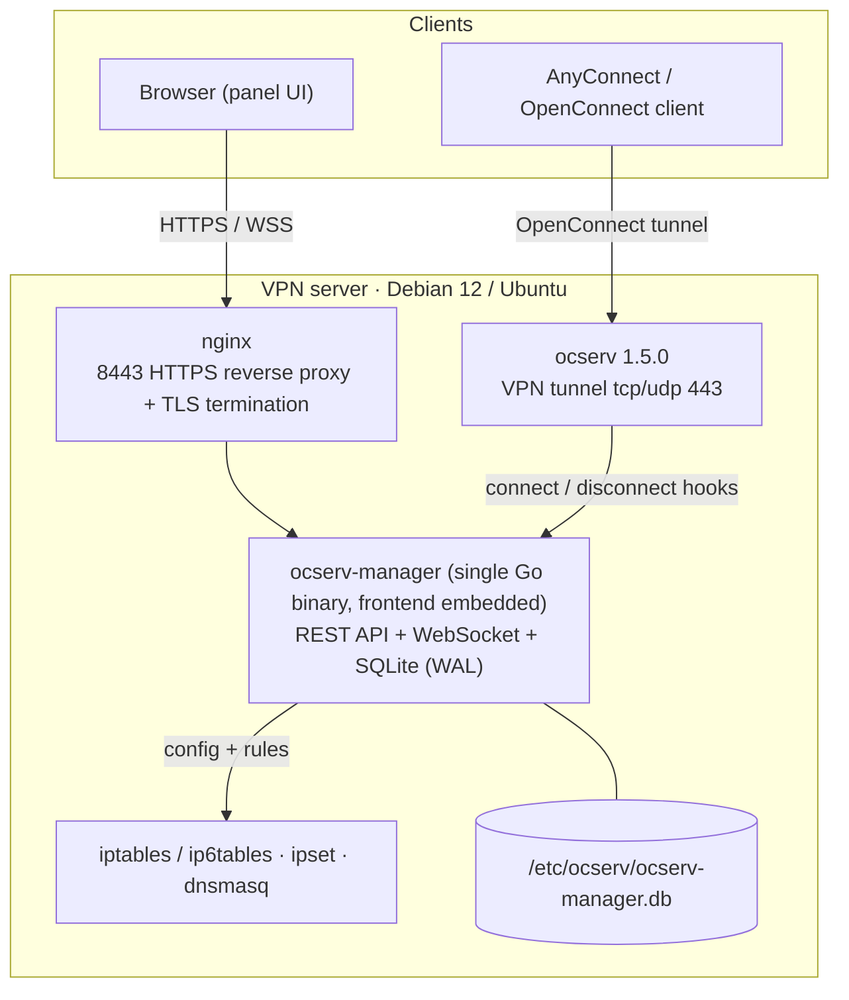
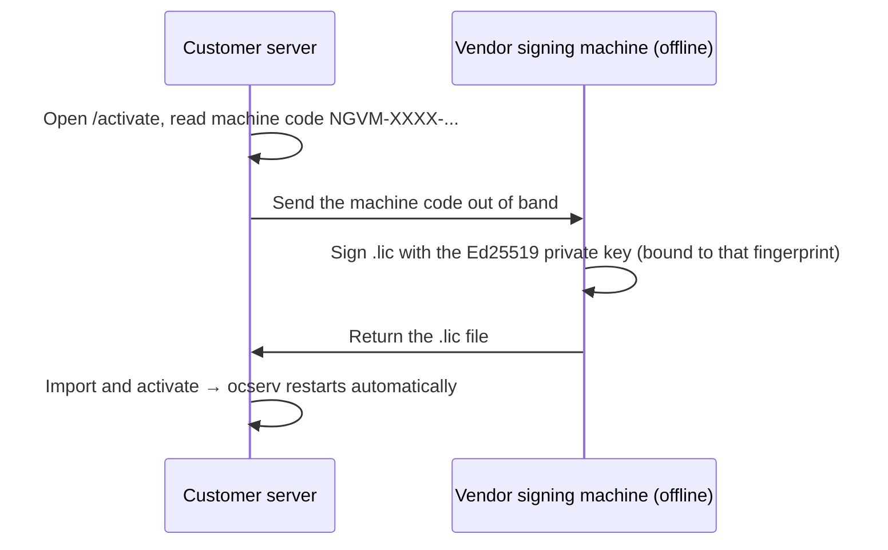

<div align="center">

# Netglimmer VPN Manager

**Enterprise-grade OpenConnect (ocserv) VPN management panel · one-click deployment · fully offline-capable**

[中文](README.md) ｜ **English**


[Quick Start](#quick-start) · [Get the Release](#get-the-release) · [Features](#feature-map) · [Architecture](#architecture) · [Install Flow](#install-flow) · [Licensing](#offline-licensing) · [FAQ](#faq)

</div>

---

Netglimmer wraps [ocserv](https://ocserv.gitlab.io/www/ocserv.html) (OpenConnect / Cisco AnyConnect-compatible VPN) into a **single-binary, offline-deployable product with a web console**: 26 functional pages covering accounts, network policy, certificates, situational awareness and backups, plus an installer that turns a clean Debian/Ubuntu box into a working VPN gateway — and rolls itself back if it fails.

| | |
|:--|--|
| **Delivery** | One 15 MB prebuilt binary (frontend embedded) + one 3,060-line installer + offline deps |
| **Runtime deps** | ocserv, nginx, dnsmasq, iptables/ipset — all installed by the script |
| **Network need** | Install and runtime can be **fully air-gapped**; offline maps, GeoIP database and licensing are built in |
| **Admin entry** | Browser HTTPS panel (default `:8443`); backend binds `127.0.0.1:8088` only |

**Who it is for**

- Teams that need remote staff, stores or branch racks to reach **internal resources** without hand-rolling bastion + routing + firewall rules
- **Air-gapped / isolated** networks where installation must not touch the internet
- Small ops teams who want **runs out of the box, with daily reports and an audit trail** when something is off

---

## Quick Start

> Requires **Debian 12 / Ubuntu (x86_64)** and **root**.

```bash
# 1. Download the release (public Releases carry the core package; the full offline
#    bundle is supplied per licensed customer — same commands, different filename)
REL=https://github.com/netglimmer/netglimmer-vpn-manage/releases/latest/download
curl -LO $REL/SHA256SUMS.txt
curl -LO $REL/netglimmer_vpn_install_v1.8_core_linux-amd64.tar.xz

# 2. Verify and extract
sha256sum -c --ignore-missing SHA256SUMS.txt
tar xf netglimmer_vpn_install_v1.8_core_linux-amd64.tar.xz
cd netglimmer_vpn_install_release

# 3. Install (the installer is embedded in the binary; no plaintext .sh ships in the package)
sudo ./ocserv-manager install

# 4. Open the panel
#    https://<server-ip>:8443        default admin / netglimmer ← change it immediately
#
# 5. VPN client address
#    https://<domain-or-ip>/?netglimmer  (enter in AnyConnect / OpenConnect)
```

> Air-gapped target? Request the **full offline bundle** (includes `offline-debs/`) from your
> supplier, copy it in, then run `sudo ./ocserv-manager install --offline` — zero network
> requests for the whole install (see Install modes below).
> Package differences and where to get each: [Get the Release](#get-the-release).

The installer asks only **3 questions**: server address (auto-detected, pick to accept), VPN client subnet (default `192.168.88.0/24`), service port (default `443`).

> **Don't mix up the two ports**: `8443` is the **management panel** HTTPS port (changeable under System Settings); `443` is the **VPN service** port (ocserv TCP + UDP on the same port). `/?netglimmer` is the connection passphrase (service camouflage), editable under Config Management.

### Install modes

| Mode | Command | Notes |
|:--|:--|:--|
| Auto (default) | `sudo ./ocserv-manager install` | Recommends offline when `offline-debs/` is present, online otherwise |
| Fully offline | `sudo ./ocserv-manager install --offline` | Never rewrites apt sources, never makes a request; fails loudly if packages are missing |
| Force online | `OFFLINE_MODE=false sudo ./ocserv-manager install` | Installs deps via apt from CN mirrors (Aliyun → Tsinghua → upstream) |

### If an install fails

The installer is **transactional**: before touching an existing deployment it snapshots configuration, database, panel binary, systemd units, iptables/ipset rules and service enabled/running state. On failure or `Ctrl+C` it **rolls back automatically** and brings the original services back up — no half-installed state taking your production VPN down. Snapshots keep the last 3 under `/var/lib/netglimmer-backup/`.

---

## Get the Release

The public **[Releases](https://github.com/netglimmer/netglimmer-vpn-manage/releases/latest)** page carries the core package; the full offline bundle is delivered per licensed customer:

| Asset | Size | Contents | How to get it |
|:--|:--|:--|:--|
| `netglimmer_vpn_install_v1.8_core_linux-amd64.tar.xz` | ~5 MB | Panel binary (**installer embedded inside**) + ocserv source, no system debs | Public Release download |
| `SHA256SUMS.txt` | < 1 KB | SHA256 of the public assets | Public Release download |
| `netglimmer_vpn_install_v1.8_linux-amd64.tar.xz` | ~124 MB | Core contents + `offline-debs/` (196 .deb files) | **Not public**: air-gapped customers request it from the supplier, with its own manifest |

```bash
# 1. Download (latest always points at the newest release)
REL=https://github.com/netglimmer/netglimmer-vpn-manage/releases/latest/download
curl -LO $REL/SHA256SUMS.txt
curl -LO $REL/netglimmer_vpn_install_v1.8_core_linux-amd64.tar.xz

# 2. Verify the package
sha256sum -c --ignore-missing SHA256SUMS.txt

# 3. Extract, then verify every file inside (each package ships its own manifest)
tar xf netglimmer_vpn_install_v1.8_core_linux-amd64.tar.xz
cd netglimmer_vpn_install_release && sha256sum -c checksums.sha256
```

> Both packages extract to a top-level directory named `netglimmer_vpn_install_release/`
> (version-independent; the binary locates bundled assets relative to its own directory).
> `wget -c $REL/<asset>` is equivalent for resumable downloads.
> Holders of the full offline bundle: replace the two `curl` lines with your local files; everything else is identical.

> **`offline-debs/` is tied to a distro version and architecture** (bundled: Debian 12 amd64). For Ubuntu 22.04, ARM64, etc., regenerate on an internet-connected machine of the **same distro, version and arch** with `sudo ./ocserv-manager pack-offline-debs`, then copy the whole tree over.
>
> **The prebuilt binary is linux/amd64.** ARM64 requires building from source on the target (or a same-arch machine).

---

## Feature Map

The 26 pages group into six domains:

| Domain | Coverage | Worth knowing |
|:--|:--|:--|
| **Accounts & access** | VPN user CRUD, CSV import/export, live sessions with one-click disconnect, connection history, user groups with per-group client subnets, self-service password reset by email | Cross-group isolation is backed by per-group catch-all DROP rules — a misconfiguration doesn't leak traffic between groups |
| **Network & policy** | Interfaces (auto/static dual mode + live throughput), static routes, NAT rules (SNAT/DNAT/MASQUERADE), access control with hit counters, full IPv6 dual stack | Static routes and NAT rules are **restored automatically after reboot** |
| **Resources & split tunneling** | Client-reachable resources (CIDR / domain) assigned per group; CIDRs pushed as VPN routes, domains released dynamically | Domain resources need no manual IP lists: the panel resolves them, writes ipsets, and follows CDN IP rotation |
| **Certificates & hardening** | Web-based CA / server / client certificate issuance, PKCS#12 export, CRL revocation, expiry reminders, automatic IP banning | Issuance happens locally with `certtool` — private keys never leave the server |
| **Observability & awareness** | Dashboard, service logs, audit log, traffic stats, **situational awareness dual map** (world/China heat + fly-lines + threat markers), full-screen big screen | The big-screen token is least-privileged: it can only read situational data, so leaking it grants nothing else |
| **Operations & delivery** | ZIP backup/restore, AES-256-GCM encrypted backups, SSH remote push, scheduled auto-backup, timezone/NTP, **daily system report**, notifications (email / Feishu / Telegram) | One report is rendered per channel: HTML tables for email, interactive card for Feishu, bold monospace for Telegram |

### Three flagship capabilities

**Situational awareness (world / China dual map)** — source countries and provinces heat-colored, animated fly-lines converging on the server's location, ripples for active sources, TOP-10 ranking; failed logins from the last 30 days and currently banned IPs overlaid as red threat markers. Map data is bundled at build time — **zero external dependency**; aggregates are cached 60 s per range (`24h / 7d / all`).

**Three-tier IP geolocation chain** — `ip2region` offline database (upload `.xdb` in the panel, ~11 MB resident) → persistent local cache (survives restarts, no online quota spent) → `ip-api.com` online fallback. In a pure offline environment it silently degrades to Unknown instead of erroring or blocking.

**Daily system report** — pushed at 09:00 by default over every enabled channel: traffic totals with 7-day trend and day-over-day delta, logins/online users and traffic TOP N, CPU/memory against alert thresholds, per-service health, audit anomalies split by category.

---

## Architecture



| Component | Role | Exposed |
|:--|:--|:--|
| `ocserv-manager` | Single Go binary: REST API + WebSocket hub + SQLite + embedded Vue frontend | `127.0.0.1:8088` only |
| `nginx` | Panel HTTPS reverse proxy and TLS termination (default `8443`; port 80 issues a 301) | Public |
| `ocserv` | OpenConnect VPN service (default `443`, TCP + UDP/DTLS) | Public |
| `dnsmasq` | Listens only on VPN tunnel devices, takes over client DNS | Tunnel only |
| Session hooks (embedded in the binary) | ocserv connect/disconnect hooks reporting real IP and traffic, written to `/etc/ocserv/` at install time | Loopback + `X-Internal-Token` |

**Security baseline**: bcrypt password storage; session tokens bound to source IP, with WebSocket torn down immediately on logout/password change/expiry; per-IP escalating login lockout (4–5 failures → 5 min, 8+ → 120 min); dual-auth internal endpoints (nginx denies external access **and** the backend compares `X-Internal-Token` in constant time, token file `0600`); real client IP prefers the un-spoofable `X-Real-IP`.

> **Takeover notice**: once an interface is switched to static mode, the panel treats `/etc/network/interfaces` as the single authoritative source and disables NetworkManager / netplan / systemd-networkd management for that interface, so multiple config sources can't fight each other. Make sure that's what you want.

---

## Install Flow


Ten steps in order: system deps → Go toolchain → Node.js → certificates → ocserv config → system network policy → build/deploy panel → start VPN → register systemd → nginx reverse proxy. **In binary delivery mode, steps 2, 3 and 7 skip the toolchain and compilation** and deploy the prebuilt artifact.

`ocserv-manager.service` declares `Wants=` (not `Requires=`) on `ocserv.service` — if the VPN dies, the panel stays reachable so you can debug and self-activate.

---

## Offline Licensing

Licensing is **purely offline**: no validation request ever leaves the machine.



| Form | Notes |
|:--|:--|
| **Trial** | Starts on first boot, **15 days full-featured**, no registration |
| **Permanent** | Valid indefinitely after import, bound to the target machine |
| **Expiry** | Valid until a given date, then back to locked state |

**Anti-tamper design**

- Machine binding: fingerprint hashed from `/etc/machine-id` + `product_uuid` + CPU model; a `.lic` is invalid on another host
- The verification public key is **compiled into the binary**, so swapping a key file cannot forge a license
- Local trial state is HMAC-signed with a per-deployment key generated randomly at first build (`/etc/.nglickey`, `0600`) — not hardcoded in source
- Clock-rollback defense: a high-water mark records the furthest-seen time; winding the clock back is treated as tampering and handled as expiry
- On expiry: an enforcer ticks every minute and stops `ocserv` while blocked; the panel stays reachable and redirects to `/activate`, and importing a valid license brings the service back

> Uninstall **intentionally preserves** license markers and trial progress (`/etc/.nglickey`, `/etc/.nglicense`, the fingerprint file), so reinstalling does not reset the trial. Before deleting anything, the active license string is also exported to `/etc/.nglicense` as a second copy.

---

## Requirements

| Item | Requirement |
|:--|:--|
| OS | Debian 12 / Ubuntu 20.04+ (bundled offline debs target Debian 12 amd64) |
| CPU / RAM | 1+ core / 512 MB+ (building the frontend from source needs ~2 GB; the installer adds temporary swap if short) |
| Disk | 2 GB+ (plus ~120 MB for offline dependencies) |
| Arch | x86_64 (ARM64 requires a source-mode build) |
| Network | Public IP or port mapping to act as a VPN gateway; management-only internal deployments also work |
| Privilege | root (iptables, ocpasswd, systemd) |

---

## Package Contents

```
netglimmer_vpn_install_release/
├── ocserv-manager              # Prebuilt panel binary (frontend + installer/hooks embedded, ~15 MB)
├── ocserv-1.5.0.tar.xz         # ocserv source (GPLv2, compiled on target)
├── offline-debs/               # 196 system .deb packages (~120 MB, full offline bundle only)
├── EULA.txt                    # End User License Agreement
└── checksums.sha256            # SHA256 integrity manifest
```

> **No plaintext implementation ships anywhere**: the installer, uninstaller, ops menu and the
> ocserv session hooks are embedded compressed inside `ocserv-manager`, extracted at runtime to a
> 0700 temp dir and removed when done; for troubleshooting use
> `sudo ./ocserv-manager --extract-scripts <dir>`. This repository likewise contains docs only.

---

## Operations Cheat Sheet

<details>
<summary><b>Common commands</b></summary>

```bash
systemctl status ocserv ocserv-manager nginx dnsmasq   # service state
journalctl -u ocserv -f                                # live VPN log
sudo ./ocserv-manager manage                         # interactive ops menu (users/bans/resources/groups/reset password/export backup)
sudo ./ocserv-manager uninstall               # uninstall
```

</details>

<details>
<summary><b>Lost admin password</b></summary>

Prefer the installer menu item "Reset admin password" (sets it to `netglimmer` and invalidates all sessions). In an emergency, write the hash directly:

```bash
/opt/ocserv-manager/ocserv-manager --hash-password 'new-password'      # bcrypt hash, no network needed
sqlite3 /etc/ocserv/ocserv-manager.db \
  "UPDATE web_admins SET password='<hash>' WHERE username='admin';"
systemctl restart ocserv-manager
```

Password policy: **8+ characters containing both letters and digits**.

</details>

<details>
<summary><b>Data cleanup and space reclaim</b></summary>

```bash
sqlite3 /etc/ocserv/ocserv-manager.db "DELETE FROM traffic_daily;"              # traffic stats
sqlite3 /etc/ocserv/ocserv-manager.db "DELETE FROM sessions WHERE status='offline';"  # history, keeps live sessions
sqlite3 /etc/ocserv/ocserv-manager.db "VACUUM;"                                 # reclaim space
```

Offline session records older than 90 days are archived into monthly CSVs and removed from the database automatically: `/var/log/ocserv-sessions/sessions_YYYY-MM.csv`.

</details>

<details>
<summary><b>Backups and remote push</b></summary>

- Contents: `ocserv.conf`, `ocpasswd`, `config-per-group/`, the SQLite database (consistent `sqlite3 .backup` snapshot)
- Encryption: AES-256-GCM with PBKDF2 key derivation; encrypted archives import directly
- Automatic: enabling it in the panel writes `/etc/cron.d/ocserv-backup`, daily at 03:00, keeping the last 30
- Off-site: push over SSH to a configured target after every backup
- **Machine-local settings never migrate**: static routes, NAT rules and system DNS are stripped on export and backfilled from the current machine on restore, so a source host's network config can't poison a new one

</details>

---

## FAQ

**The panel won't load — wrong port?**
The panel defaults to **8443**, not 443 (443 is the VPN port). Check your security group / upstream firewall for the panel port, and `systemctl status nginx ocserv-manager`.

**My target machine has no internet at all. Can it still install?**
Yes. Use the full package with `--offline`: system deps from local debs, ocserv compiled from the bundled source, panel as a prebuilt binary (frontend embedded — no Node/npm involved). Zero outbound traffic.

**What about Ubuntu or ARM64?**
`offline-debs/` is bound to distro version and architecture — regenerate it with `ocserv-manager pack-offline-debs` on a matching connected machine. ARM64 additionally needs a source-mode panel build (the prebuilt binary is amd64).

**What happens when the license expires?**
The VPN service is stopped automatically within a minute; the panel stays reachable and redirects to `/activate`. Importing a valid license restores the service. User data, configuration and certificates are untouched.

**Does it phone home?**
No. Licensing and trial validation are entirely offline; maps and IP geolocation use bundled offline data. Only capabilities **you** configure generate traffic: SMTP notifications, Feishu/Telegram webhooks, NTP, and the optional `ip-api.com` geolocation fallback (which silently degrades when offline).

**Will changing config disconnect active users?**
Domain pass-through, resource and group changes apply within seconds without dropping active sessions. DNS and route pushes happen at authentication time, so those require a client reconnect.

**Upgrading — do I reinstall?**
No. Replace the `ocserv-manager` binary and `systemctl restart ocserv-manager`. License, user data and configuration are preserved.

---

## Security & Compliance

- **Default credentials**: `admin / netglimmer` exists only for first login — **change it immediately**; all online sessions are invalidated on change.
- **Exposure**: the backend listens on `127.0.0.1:8088` only; public entry points are nginx TLS and the ocserv VPN port.
- **`TRUSTED_PROXY`**: keep it `false` unless a trusted reverse proxy genuinely supplies the client IP, otherwise clients can spoof their source address.
- **Open-source components**: ocserv ships as GPLv2 source and is compiled on the target; nginx, dnsmasq, iptables and ipset come from system packages. The panel itself is **commercial proprietary software** — see [EULA.txt](EULA.txt).
- **Vulnerability disclosure**: report privately per [SECURITY.md](SECURITY.md), not through public issues.

---

## Version & Support

- Current version: **v1.8** — see [CHANGELOG.md](CHANGELOG.md)
- License: commercial proprietary software under [EULA.txt](EULA.txt); no copying, distribution, modification or resale without authorization
- Licensing questions, support and bug reports: open an [Issue](https://github.com/netglimmer/netglimmer-vpn-manage/issues) or contact your Netglimmer vendor

<div align="center">

**Netglimmer VPN Manager** · Go + Vue 3 + ocserv · v1.8

[Back to top](#netglimmer-vpn-manager)

</div>
